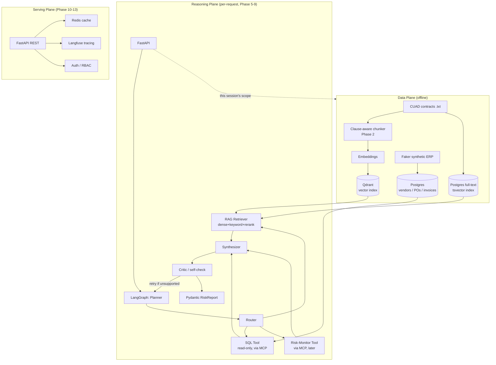

# ProcureIQ — Architecture (v1, reduced scope)

## System diagram

## Component responsibilities (v1)

| Layer | Component | Responsibility | Built in |
|---|---|---|---|
| Data | CUAD extractor | Pull raw contract text + clause labels out of `CUADv1.json` into per-contract `.txt` + metadata | **Phase 1 (this session)** |
| Data | Synthetic ERP generator | Faker-based vendors/POs/invoices, linked to a subset of CUAD contracts by `vendor_id` | **Phase 1 (this session)** |
| Data | Postgres schema | Structured store for vendors/POs/invoices (full-text index added Phase 2) | **Phase 1 (this session)** |
| Data | Clause-aware chunker + Qdrant loader | Chunk by clause boundary, embed, index | Phase 2 |
| Reasoning | LangGraph state machine | Planner → Router → tools → Synthesizer → Critic | Phase 5-8 |
| Reasoning | SQL tool (MCP) | Read-only, schema-constrained SQL against Postgres | Phase 6-7 |
| Serving | FastAPI + Redis + auth | Public-facing API, caching, RBAC | Phase 10 |
| Ops | Langfuse + eval CI | Tracing + regression-gated evaluation | Phase 11-12 |

## Why CUAD + synthetic ERP, concretely
CUAD gives us the hard part — real legal language with genuine ambiguity — for free. The
41 expert-labeled clause categories per contract (Cap On Liability, Renewal Term, Termination
For Convenience, Anti-Assignment, ...) become the backbone of:
1. Clause-aware chunking metadata (Phase 2)
2. A near-automatic path to building the gold evaluation question set (Phase 4), since we
   already know which contract/clause pairs contain the answer to "what's the liability cap
   in vendor X's contract?" style questions.

The synthetic ERP layer exists purely to give the SQL tool something real to query — spend
totals, PO dates, invoice status — linked to the same vendors whose contracts live in Qdrant/
Postgres full-text. This linkage (contract_id ↔ vendor_id) is what makes a query like "vendors
with >$500K spend AND uncapped liability" a genuine multi-hop, multi-source problem instead of
a single-index lookup.
