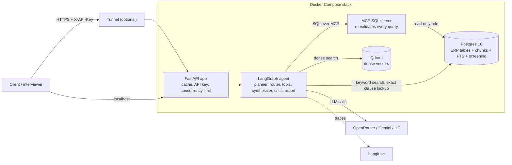

# ProcureIQ: Build Document

Agentic RAG for procurement contract and spend intelligence. This document describes what the
system is, how it is built, why it is built that way, and how to run, test, operate and extend
it. It is written for engineers (and for interviewers who want the engineering detail).

> **Conventions.** "Phase N" uses the project README's numbering (0 to 13). The original learning
> guide numbers phases differently; section 2 maps one to the other. Test counts are the numbers
> printed by the offline suites at the time of writing. Everything not marked "verified" or "tested"
> is stated as a limitation in section 12.

---

## 1. What ProcureIQ is

A system that answers multi-hop questions that need **both** contract text and structured spend
data, and returns a validated, cited **Risk Report** instead of free text. Example:

> "Which vendors with total purchase-order spend above $1,000,000 have contracts that include an
> uncapped liability clause?"

No single lookup answers that. The spend comes from SQL tables, the clause comes from contract
text, and the second step depends on the first. ProcureIQ plans the question, routes it to the
right tool(s), runs SQL first when needed, narrows the contract search to the contracts SQL found,
drafts an answer, **checks its own answer**, retries if the check fails, and finally assembles a
structured report whose figures come from the tools, not from the language model.

Design principles that run through every phase:

1. **Tools produce facts, the model writes prose.** Numbers, ids and citations in the report are
   built in plain Python from tool output. The LLM is never asked to emit JSON.
2. **Defence in depth.** No single control (prompt, validator, database role) is trusted alone.
3. **Everything is testable offline.** Every external dependency (LLM, embedder, reranker,
   database, Qdrant, Langfuse, Docker, cloud) has an injectable fake, so the logic is tested without
   services, keys or network.
4. **Measure, don't claim.** Regression gate, drift tests and mutation checks exist so that
   statements about the system can be backed by numbers.
5. **Honest limits.** Known gaps are written down (section 12) and pinned by tests where possible.

---

## 2. Status and numbering

| Phase | What | Status | Tests |
|---|---|---|---|
| 0 | Architecture and setup | Done | n/a |
| 1 | Data: CUAD contracts + synthetic ERP | Done | n/a |
| 2 | Ingestion: clause-aware chunking, Qdrant + full-text | Done | n/a |
| 3 | Hybrid retrieval (dense + keyword + RRF + cross-encoder) + baseline RAG | Done | n/a |
| 4 | Baseline evaluation (gold questions) | Tooling built; README marks the run as skipped | `eval/test_offline.py` |
| 5 | LangGraph agent: planner, router, RAG tool, synthesizer, critic, retry loop | Done | covered by phase-6 suite |
| 6 | SQL tool, real router (`rag`/`sql`/`both`), SQL-narrowed multi-hop retrieval | Done | 115 checks |
| 7 | Structured `RiskReport`, prompt-injection guardrails, adversarial suite | Done | 140 checks |
| 8 | FastAPI serving layer: `/ask`, `/ask/stream`, cache, API key, concurrency limit | Done | 53 checks |
| 9 | MCP wrapper for the SQL tool (stdio and HTTP) | Done | 34 checks |
| 10 | Risk monitor v1: OFAC sanctions screening of vendors | Done | 34 checks |
| 11 | Observability: Langfuse tracing | Done | 39 checks |
| 12 | Containerization: one image, compose profiles, smoke test | Done (verified on the author's machine) | 73 checks |
| 13a | CI (GitHub Actions), secret scanner, regression gate | Done | 23 + 24 checks |
| 13b | Optional cloud deployment (Cloud Run + Neon + Qdrant Cloud) | Built, not run against real accounts | 96 checks |
| 13c | Free public access from your own PC (tunnel) | Done: Cloudflare quick tunnel verified end to end on the author's machine; ngrok option untested | 83 checks |
| 14 to 17 | Remaining work, including the demo UI in Phase 15 (section 13) | Planned | |

Over 700 automated checks across 13 offline suites, all run in CI.

**Mapping to the original learning guide**

| Guide phase | Project phases |
|---|---|
| 0 Foundations and data | 0, 1 |
| 1 Ingestion pipeline | 2 |
| 2 Baseline retrieval + evaluation harness | 3, 4 |
| 3 Agentic orchestration (+ MCP, risk tool) | 5, 6, 9, 10 |
| 4 Structured outputs and guardrails | 7 |
| 5 Serving layer (JWT, RLS, cache) | 8 (API key and cache done; JWT/RLS not done) |
| 6 Observability and regression testing | 11, 13a |
| 7 Containerization and deployment | 12, 13b, 13c |
| 8 "Wow factor" add-ons | not started (section 13) |
| 9 Polish for the hiring committee | not started (section 13) |
| (not in the guide) Demo user interface | Phase 15, not started (section 13) |

---

## 3. Architecture

### 3.1 Components



### 3.2 Life of one question

1. **API** validates the request (`AskRequest`: question 3 to 1000 chars, hidden characters
   stripped), checks the API key (constant-time compare), and looks in the answer cache.
2. A semaphore admits the run (default 2 concurrent; others wait up to 30 s, then get 503 +
   `Retry-After`).
3. **Planner** sets the search query (on a retry it asks the LLM to rewrite the query using the
   critic's feedback).
4. **Router** picks `rag`, `sql` or `both` from deterministic signals; one LLM call only if no
   signal fires at all; default `rag`.
5. **SQL tool** (routes `sql`, `both`): LLM writes SQL from the question and the schema; the
   validator parses it into an AST, allow-lists tables and functions, and re-renders it; the
   executor runs it in a READ ONLY transaction with a 5 s timeout and 200-row cap. When the backend
   is `mcp`, the same validation runs again inside the MCP server.
6. **RAG tool** (routes `rag`, `both`): hybrid retrieval (dense 20 + keyword 20, RRF fusion with
   k=60, cross-encoder rerank, final 8). On `both`, retrieval is filtered to the `contract_id`s SQL
   found, and an **exact clause lookup** (CUAD expert labels) checks *all* candidates instead of
   hoping the right chunk ranks highly.
7. **Synthesizer** writes the answer. Untrusted text (contract chunks, DB cells) is sanitized and
   labelled as data first; the final answer passes an output guard.
8. **Critic** (deterministic, no LLM): the answer must be non-empty; every `[contract_id]` it cites
   must have actually been retrieved. On failure it blames a tool (`failure_source`) and sends the
   run back to the planner. After `max_retries` (default 2, maximum 3) it gives up honestly.
9. **Report** builds the validated `RiskReport` from tool output (see 6, Phase 7).
10. API caches trustworthy results only, returns the report with `request_id`, `cached`,
    `latency_s`; the whole run is traced in Langfuse.

### 3.3 Agent graph

```
START -> Planner -> Router --rag---> RAG tool ----------------------------> Synthesizer
                      |                                                         ^
                      +--sql---> SQL tool --ok, route=sql----------------------+
                      |             |                                           |
                      +--both--> SQL tool --ok, route=both--> RAG tool ---------+
                                    |
                                    +--error--> Critic (skips synthesis)

Synthesizer -> Critic --accept / give_up--> Report (validated RiskReport) -> END
                      --retry-------------> Planner
```

On a retry the router keeps the original route, so a retry cannot flip-flop between tools.

### 3.4 Agent state (`agent/state.py`)

| Field | Meaning |
|---|---|
| `question` | original question, never mutated |
| `search_query` | query for retrieval (rewritten on retry; narrowed on `both`) |
| `route` | `rag` / `sql` / `both` |
| `retrieved_chunks`, `answer`, `citations` | retrieval output, answer text, contract ids actually cited |
| `verdict`, `critic_feedback`, `failure_source` | critic outcome and which tool it blamed |
| `retry_count`, `max_retries` | loop control |
| `sql_query`, `sql_columns`, `sql_rows`, `sql_truncated`, `sql_error` | SQL tool result |
| `contract_filter` | contract ids found by SQL, used to narrow RAG |
| `clause_category`, `clause_note` | exact clause lookup (CUAD label) and its deterministic summary |
| `guardrail_flags` | every sanitisation / output-guard event |
| `report` | the validated `RiskReport` as a dict |
| `trace` | human-readable log of which nodes ran and why |

---

## 4. Repository layout

```
agent/            the agent
  state.py          AgentState (TypedDict)
  router.py         signals-first routing: rag / sql / both
  nodes.py          node factories: planner, router, sql_tool, rag_tool, synthesizer, critic, report
  graph.py          LangGraph wiring + run_agent() + CLI
  sql_tool.py       validated read-only Text-to-SQL (4 layers)
  prompts.py        SQL prompt, synthesis prompt, schema description
  schemas.py        RiskReport / Finding (Pydantic) and the report builder
  guardrails.py     prompt-injection defences
  mcp_client.py     MCPSQLExecutor: drop-in executor that calls the MCP server
  observability.py  Langfuse tracing layer (no-op without keys)
  scan_corpus_for_injection.py   audit your own chunks against the guardrail patterns
  test_*_offline.py  suites: phase6 (115), guardrails (140), observability (39)
api/              serving layer
  app.py            create_app(): endpoints, auth, cache, concurrency, errors
  main.py           real wiring (models, Qdrant, graph) for uvicorn
  cache.py          thread-safe TTL + LRU answer cache
  test_api_offline.py  (53)
retrieval/        hybrid retrieval and generation
  keyword_retriever.py  Postgres full-text (ts_rank)
  dense_retriever.py    Qdrant search (optional contract_id filter)
  fusion.py             Reciprocal Rank Fusion
  reranker.py           cross-encoder rerank
  hybrid_retriever.py   dense + keyword -> RRF -> rerank
  category_lookup.py    exact CUAD-label lookup for the `both` route
  generator.py          LLM providers (openrouter, gemini, huggingface, fake)
  baseline_rag.py       Phase 3 baseline endpoint
ingestion/        clause_chunker, embedder, build_qdrant_index, load_fulltext_postgres, load_cuad_documents
erp/              schema.sql, generate_synthetic_erp.py, load_erp_to_postgres.py,
                  create_readonly_role.sql (+ _cloud.sql variant that takes the password as a parameter)
mcp_servers/      sql_server.py (MCP server), test_mcp_offline.py (34)
risk/             matcher.py, ofac_loader.py, screen_vendors.py, schema_risk.sql, fixtures/, test (34)
eval/             build_gold_questions, run_baseline_eval, run_agent_eval, metrics, agent_metrics,
                  check_regression.py (quality gate) and offline tests
infra/            Dockerfile, docker-compose.yml, smoke_test.ps1, go_public.ps1,
                  deploy_gcp.ps1, migrate_data.ps1, render_service.py, cloudbuild.yaml, tests
scripts/          extract_cuad_contracts.py, check_no_secrets.py (+ test)
.github/workflows/  ci.yml, keepalive.yml (cloud path only)
requirements.txt (dev) | requirements-api.txt (image) | requirements-ci.txt (CI)
.env.example  .gitignore  .dockerignore  .gcloudignore
```

---

## 5. Data

| Store | Contents |
|---|---|
| **CUAD** (source) | 510 real commercial contracts, 41 expert-labelled clause categories, 13,823 labelled clause spans |
| **Postgres 16** | `vendors`, `cuad_documents`, `contracts`, `purchase_orders`, `invoices`, `contract_chunks` (about 42K chunks; `categories` array with GIN index; `search_vector` tsvector with GIN index), view `vendor_annual_spend`; Phase 10 adds `sanctions_entries`, `sanctions_list_info`, `vendor_risk_screening` |
| **Qdrant** | collection `contract_chunks`: dense vectors (384-d, BAAI/bge-small-en-v1.5) with payload used for `contract_id` filtering |
| **Synthetic ERP** | Faker-generated: 120 vendors linked 1:1 to real CUAD `contract_id`s, with purchase orders and invoices. Clearly synthetic. |
| **OFAC SDN list** | about 19.4K primary records and 20.2K aliases (entities, individuals, vessels, aircraft) |

The join between a real vendor, its real contract id and its spend total is what makes the multi-hop
questions meaningful. `erp/schema.sql` is **destructive** (it drops every table); after re-applying
it, redo the full load sequence (Quick start, step 4).

---

## 6. Phases in detail

### Phase 0 and 1: setup and data
Goal: a realistic corpus and a structured dataset that join. `scripts/extract_cuad_contracts.py`
turns CUAD's JSON into one text file per contract plus `clauses.jsonl` (every labelled span).
`erp/generate_synthetic_erp.py --n-vendors 120 --seed 42` generates vendors, POs and invoices
deterministically. `erp/schema.sql` defines the tables.

### Phase 2: ingestion
- **Clause-aware chunking** (`ingestion/clause_chunker.py`): instead of fixed windows that cut a
  liability clause in half, CUAD's labelled spans are anchors; overlapping spans are merged and each
  is expanded to the nearest paragraph break (capped), so every chunk is self-contained and carries
  its expert labels in `categories`.
- **Embedder** (`ingestion/embedder.py`): sentence-transformers `bge-small-en-v1.5`; a fake embedder
  exists for tests.
- **Two indexes**: Qdrant (dense) and Postgres full-text (keyword). `cuad_documents` is the contract
  registry loaded first.

### Phase 3: hybrid retrieval and baseline RAG
Dense and keyword scores live on unrelated scales, so **Reciprocal Rank Fusion** (`k=60`) uses only
rank positions. A **cross-encoder** (`ms-marco-MiniLM-L-6-v2`) then reorders the shortlist, which is
more accurate than the bi-encoder but too slow for the whole corpus. Defaults: dense 20, keyword 20,
final 8. `baseline_rag.py` is the non-agentic yardstick. Providers: OpenRouter (default), Gemini,
Hugging Face, and a fake provider.

### Phase 4: baseline evaluation (tooling built)
`eval/build_gold_questions.py` builds a **109-question gold set**: 104 single-hop questions whose
ground truth comes straight from CUAD's own labels (no manual labelling) and 5 multi-hop questions.
`run_baseline_eval.py` and `run_agent_eval.py` score with deterministic metrics (chunk hit-rate;
vendor-set precision/recall/F1 for tools and answer text; routing accuracy), no LLM judge, so runs
are cheap on free tiers. The README marks the baseline run as skipped; running it and blessing the
result is the first remaining item (section 13).

### Phase 5: the agent
LangGraph state machine with a self-correcting loop. The critic is deliberately deterministic: it
checks that every cited `[contract_id]` was retrieved. **A real bug this caught:** CUAD text contains
redaction placeholders like `[Redacted]`; an early critic regex matched any bracketed word and
rejected well-grounded answers. The regex now matches the exact id shape `\d{4}_\w+`.

### Phase 6: SQL tool and real routing
- **Router**: regex/keyword signals first (structured-data words, clause topics), an LLM tiebreak
  only when nothing fires, default `rag`. Same input always routes the same way.
- **SQL tool, four layers**: (1) prompt says SELECT only (advisory); (2) `sqlglot` validator parses
  to an AST, accepts exactly one SELECT over an allow-list of tables, blocks dangerous functions, and
  executes its own re-rendering, so there is no gap between what was checked and what ran;
  (3) executor: READ ONLY transaction, 5 s statement timeout, 200-row cap; (4) optional read-only
  Postgres role (`erp/create_readonly_role.sql`).
- **Multi-hop**: SQL runs first; its `contract_id`s narrow retrieval; the exact clause lookup checks
  all candidates against CUAD labels.
- Live DB-level proof: `agent/test_sql_live.py` (needs the stack running).

### Phase 7: structured output and guardrails
- **`RiskReport`** (Pydantic, `extra="forbid"`): `question`, `route`, `summary`, `findings[]`
  (`vendor_name`, `contract_id`, `statement`, `basis` in {`exact_label`, `database_row`,
  `retrieved_excerpt`, `cited_in_answer`}, `figures`), `citations`, `sql_query`, `confidence`
  (high/medium/low), `verdict` (accept/give_up), `retries`, `warnings`, `guardrail_flags`.
  Prose is written by the LLM; structure is built in Python from tool results. If validation ever
  fails, a minimal valid report that says so is returned: the pipeline never returns unvalidated output.
- **Guardrails against indirect prompt injection** (OWASP LLM01): (1) structure: retrieved text
  never chooses a tool, route or SQL; (2) sanitize untrusted text (invisible characters, suspected
  instruction sentences, forged delimiters) and record every removal; (3) label excerpts as data;
  (4) output guard strips markdown images and novel URLs (data-exfiltration channel).
  Layer 2 is pattern-based and tuned for high precision; the suite documents a known paraphrase gap.
- `scan_corpus_for_injection.py` measures false positives on the real 42K chunks.

### Phase 8: serving layer
Endpoints are plain `def` (the agent is blocking code), so FastAPI runs them in worker threads and
`/health` stays responsive. Models, Qdrant client and the compiled graph are built once at startup.
A semaphore bounds concurrent runs. Errors never leak internals (client gets a `request_id`; the
traceback goes to the log). Cache: exact-match on a normalized key (`max_retries|casefolded,
whitespace-collapsed question`), 256 entries, 600 s TTL, and **only trustworthy results are cached**
(verdict accept, no SQL error, confidence not low, no guardrail events). `refresh: true` bypasses it.

### Phase 9: MCP wrapper
`mcp_servers/sql_server.py` exposes two read-only tools, `get_schema` and `run_readonly_sql`, over
stdio or streamable HTTP. It does **not** expose Text-to-SQL: the LLM stays in the agent and the
server only receives SQL, which it **re-validates** (the security boundary moves out of the agent).
`agent/mcp_client.py` provides `MCPSQLExecutor`, a drop-in for `execute_readonly` that plugs into the
graph's existing `sql_executor` hook with no graph changes. It owns one background event loop and one
long-lived session (the pipeline is synchronous, the MCP SDK async), reconnects once on failure, and
forwards only `POSTGRES_*` variables to a spawned child (no LLM keys). Select with
`PROCUREIQ_SQL_BACKEND=local|mcp`. Lessons: the folder must be named `mcp_servers` (a folder named
`mcp` would shadow the real package); a missing server script now produces a readable error.

### Phase 10: risk monitor v1 (OFAC)
Batch name screening of every vendor against the OFAC SDN list, results stored in the database so the
existing SQL route can answer risk questions with no graph change.
- `ofac_loader.py`: parses the header-less `SDN.CSV`/`ALT.CSV`, full refresh in one transaction,
  records file hashes.
- `matcher.py`: **block, then score**: normalize (accents, punctuation, legal suffixes, filler,
  generic words), block on 4-letter token prefixes, score sorted-token similarity (difflib). Status:
  REVIEW at 0.90, WEAK_MATCH at 0.80. Entities only by default (vendors are companies).
- `screen_vendors.py` writes `vendor_risk_screening` and `vendors.risk_tier`
  (`SANCTIONS_REVIEW` / `CLEAR`).
- A REVIEW is a **name-similarity flag for a human**, never a finding that a vendor is sanctioned;
  the synthesis prompt enforces that wording. On the real list the 120 vendors produced 0 REVIEW and
  1 WEAK_MATCH, which is the expected outcome for synthetic names.

### Phase 11: observability
Langfuse v4 (OpenTelemetry-based). One trace per question; spans for each node (typed: chain, tool,
retriever, guardrail) with each LLM call as a nested `generation`; scores `verdict`, `retries`,
`confidence`. Nodes and the generator are **wrapped from outside** (`traced_node`, `TracedGenerator`),
so agent logic is untouched. Tracing never breaks a request (every call guarded) and is a free no-op
without keys. `LANGFUSE_CAPTURE_CONTENT=false` redacts all text before export. Tested with the real
SDK and an in-memory exporter. Not traced: `/ask/stream` (its steps run across several threads).

### Phase 12: containerization
One image for two services (API and MCP SQL server): `python:3.12-slim`, CPU-only PyTorch (the
default Linux wheel is a multi-GB CUDA build), model weights baked in with `HF_HUB_OFFLINE=1`,
non-root user. Compose keeps the dev workflow (default profile starts only Postgres and Qdrant);
the full stack is `--profile app`. Each service lists exactly the env vars it needs (the SQL
container never sees LLM keys); published ports are bound to loopback. **Do not move the compose
file or add a `name:` key**: volumes are prefixed by the project name (`infra`) and changing it
creates new empty volumes. Verified with `infra/smoke_test.ps1` on the author's machine.

### Phase 13a: CI, secret scanning, regression gate
- **CI** (`ci.yml`): `tests` (secret scan + every `*offline*.py` suite in a lean environment),
  `docker-config` (hadolint + compose validation incl. tunnel profiles), `stack-smoke` (builds the
  image, starts the real containers with fake models, asserts `/ready` including `mcp_sql`, one
  `/ask`). Action versions are the Node 24 majors (Node 20 was removed from runners on 2026-09-16).
- **Secret scanner** (`scripts/check_no_secrets.py`): fails on a tracked `.env` or key-shaped strings;
  prints matches masked.
- **Regression gate** (`eval/check_regression.py`): compares an agent eval run with a blessed
  baseline. Fails if a rate metric drops more than 0.05, an errored/SQL-error item appears, give-ups
  increase, or a metric disappears; latency and retries only warn. Exit 0 pass, 1 regression, 2 not
  comparable. Runs locally (needs data and an LLM key), not in CI.

### Phase 13b: optional cloud deployment (built, not run against real accounts)
One Cloud Run service with two containers (API plus the MCP SQL server as a sidecar on
`127.0.0.1`), Neon Postgres, Qdrant Cloud, Secret Manager. `render_service.py` builds and validates
the service YAML; `deploy_gcp.ps1` does setup/build/deploy; `migrate_data.ps1` moves Postgres (dump,
restore, parameterized read-only role, count check) and Qdrant (snapshot upload, count check).
Verified against real Postgres 16 and real Qdrant 1.12.4 servers and against fake `gcloud`. Facts that
shaped it: Qdrant Cloud's free cluster pauses after 7 days idle and is deleted after 4 weeks;
Neon Free is 0.5 GB; any Cloud Run container under 1 vCPU forces concurrency 1 for the whole service.

### Phase 13c: free public access from your PC
`infra/go_public.ps1` starts the stack plus a tunnel container (Cloudflare quick tunnel by default;
ngrok for a permanent address). It refuses to expose the API without an API key (generates and saves
one), checks the public URL from outside, and runs the smoke test through it. The tunnel makes only
outbound connections. **Self-healing**: a quick-tunnel address dies for good when the PC sleeps, the
network changes or Docker restarts, yet the old container and its old URL in the logs remain. If the
detected URL does not answer `/ready`, the script says why (HTTP status or connection error), recreates
the tunnel container once for a fresh address and re-checks; if that also fails it prints the tunnel's
own last log lines and concrete next steps instead of looping. A URL given with `-PublicUrl`, and the
ngrok provider, are never "healed". Verified against a fake docker and fake API servers (including one
that answers 530 like a dead tunnel) under PowerShell 7, with the real `cloudflared` binary accepting the
compose arguments, and run end to end by the author on Windows (public `/ready` and both smoke questions
through the tunnel). The quick-tunnel URL changes on every start and `/ask/stream` does not work through it.

---

## 7. Security model

| Threat | Controls |
|---|---|
| Prompt injection via contract text or DB cells | structure (retrieved text never selects tools/SQL), sanitize, label as data, output guard; corpus scanner; adversarial suite |
| LLM-written SQL doing damage | prompt, AST validator + re-rendered execution, READ ONLY txn + timeout + row cap, read-only DB role, re-validation inside the MCP server, SQL sidecar bound to localhost |
| Data exfiltration through the answer | output guard strips images and novel URLs |
| Unauthorized API use | `X-API-Key` (constant-time compare); `go_public.ps1` refuses to expose without a key; `/health` and `/ready` are open |
| Secret leakage | `.gitignore`, `.dockerignore`, `.gcloudignore`; secret scanner (local and CI); per-service env allow-lists; secrets written without trailing newline; Secret Manager in the cloud path; Langfuse content redaction switch |
| Over-exposed services | Postgres/Qdrant bound to loopback; tunnel opens no inbound port; MCP server has no published port |
| Resource exhaustion | concurrency semaphore (503 + Retry-After), request size limits, row cap, statement timeout |
| Supply chain | pinned image tags and action majors; pinned runtime requirements; hadolint |

Not covered: per-user authorization, row-level security, audit logging, rate limiting per client
(section 13).

---

## 8. Configuration reference

Set in `.env` (copy `.env.example`). Blank means default or off.

| Variable | Default | Purpose |
|---|---|---|
| `PROCUREIQ_PROVIDER` | `openrouter` | LLM provider: openrouter, gemini, huggingface, fake |
| `OPENROUTER_API_KEY`, `OPENROUTER_MODEL`, `GEMINI_API_KEY`, `HF_TOKEN` | | provider credentials / model |
| `POSTGRES_HOST/PORT/DB/USER/PASSWORD` | localhost / 5432 / procureiq / postgres / postgres | main database role |
| `POSTGRES_RO_USER`, `POSTGRES_RO_PASSWORD` | | read-only role used by the SQL tool when set |
| `PGSSLMODE` | | `require` for managed Postgres (libpq reads it) |
| `QDRANT_URL` | `http://localhost:6333` | Qdrant server |
| `QDRANT_API_KEY` | | Qdrant Cloud key (blank for local) |
| `QDRANT_PATH` | | file-based local Qdrant (demos/tests) |
| `PROCUREIQ_SQL_BACKEND` | `local` | `local` in-process or `mcp` through the MCP server |
| `PROCUREIQ_MCP_SQL_URL` | | HTTP MCP server URL (else a stdio child is spawned) |
| `PROCUREIQ_MCP_TIMEOUT_S` | 20 | per-call MCP timeout |
| `PROCUREIQ_API_KEY` | | required header value for `/ask*`; unset means open |
| `PROCUREIQ_CACHE_TTL_S`, `PROCUREIQ_CACHE_MAX` | 600, 256 | answer cache |
| `PROCUREIQ_MAX_CONCURRENT`, `PROCUREIQ_QUEUE_TIMEOUT_S` | 2, 30 | concurrency limit and wait |
| `PROCUREIQ_FAKE_MODELS` | 0 | `1` = fake embedder/reranker (plumbing tests) |
| `LANGFUSE_PUBLIC_KEY`, `LANGFUSE_SECRET_KEY`, `LANGFUSE_HOST` | | tracing (off without keys) |
| `LANGFUSE_TRACING_ENABLED`, `LANGFUSE_CAPTURE_CONTENT` | true, true | kill switch; `false` redacts text |
| `NGROK_AUTHTOKEN`, `NGROK_DOMAIN` | | permanent public URL option |

---

## 9. API reference

| Method and path | Auth | Purpose |
|---|---|---|
| `POST /ask` | key if set | run the agent, return one JSON response |
| `POST /ask/stream` | key if set | Server-Sent Events: one event per graph step, then the final report |
| `GET /health` | open | liveness (never touches dependencies) |
| `GET /ready` | open | readiness: Postgres, Qdrant, models, and `mcp_sql` when the MCP backend is active; 503 if not ready |

**Request** (`extra` fields are rejected): `question` (3 to 1000 chars), `max_retries` (0 to 3,
default 2), `include_trace` (default false), `refresh` (default false: bypass cache).

**Response**: `request_id`, `cached`, `latency_s`, `report` (`RiskReport`, section 6 Phase 7),
optional `trace`. Headers: `X-Request-ID`; `X-Cache: HIT|MISS`; on overload 503 with
`Retry-After: 10`.

```powershell
$body = @{ question = "Who are the top 5 vendors by total spend?" } | ConvertTo-Json
(Invoke-RestMethod -Uri http://localhost:8000/ask -Method Post -ContentType "application/json" `
   -Headers @{ "X-API-Key" = "<key>" } -Body $body).report
```

---

## 10. Testing and CI

Every suite is a plain script (`python <file>`) that prints PASS/FAIL per check and exits non-zero on
failure. CI discovers every `*offline*.py`.

| Suite | Checks | Covers |
|---|---|---|
| `agent/test_phase6_offline.py` | 115 | SQL validator, router, filters, full graph with scripted LLM |
| `agent/test_guardrails_offline.py` | 140 | adversarial injection suite, report building, output guard |
| `agent/test_observability_offline.py` | 39 | real Langfuse SDK + in-memory exporter: span tree, errors, redaction, scores, concurrency, API |
| `api/test_api_offline.py` | 53 | real graph behind the real app, scripted LLM |
| `mcp_servers/test_mcp_offline.py` | 34 | protocol, rejection before execution, stdio child process, threads, reconnect, graph through MCP |
| `risk/test_risk_offline.py` | 34 | parsing, matching, scale (40K names) |
| `eval/test_agent_eval_offline.py`, `eval/test_offline.py` | 22, n/a | scoring logic |
| `eval/test_regression_gate_offline.py` | 24 | quality gate, incl. metric-name drift guard |
| `scripts/test_check_no_secrets_offline.py` | 23 | scanner |
| `infra/test_infra_offline.py` | 73 | compose/Dockerfile/CI drift, `.gitignore` via real `git check-ignore` |
| `infra/test_cloudrun_offline.py` | 96 | Cloud Run definition, deploy/migrate scripts |
| `infra/test_public_offline.py` | 83 | tunnel services; runs the real script against a fake docker (Linux/macOS with pwsh) |
| `agent/test_sql_live.py` | | live DB proof (needs the stack; not in CI) |

Practices worth knowing:
- **Fakes everywhere**: scripted LLM, fake embedder/reranker, injectable SQL executor, fake docker,
  fake gcloud, in-memory span exporter.
- **Mutation checking**: for the infra and deployment suites, defects were injected on purpose (leaked
  key, exposed port, renamed secret, wrong URL pick...) to prove the tests fail when they should.
  Two vacuous checks were found and replaced this way.
- **Drift guards**: compose vs `.env.example`, requirements vs imports, gated metric names vs the eval
  harness, baked model names vs code defaults, PowerShell secret names vs the service YAML.
- **What CI does not do**: score answer quality (needs data and an LLM key), run a live integration
  test with real models. `stack-smoke` uses fake models to prove the wiring only.

---

## 11. Operations runbook (PowerShell)

**Quick start**
```powershell
git clone --depth 1 https://github.com/TheAtticusProject/cuad.git data_source_cuad
Expand-Archive data_source_cuad\data.zip -DestinationPath data_source_cuad\data
python -m venv venv; .\venv\Scripts\Activate.ps1
pip install -r requirements.txt
python scripts/extract_cuad_contracts.py --source data_source_cuad/data/CUADv1.json --out data/raw/cuad
docker compose -f infra/docker-compose.yml up -d
# erp/schema.sql is applied automatically the first time Postgres starts on an empty volume.
# To re-apply it by hand (DESTRUCTIVE: drops every table, so redo all the loads below):
#   Get-Content erp\schema.sql | docker exec -i procureiq_postgres psql -U postgres -d procureiq
python ingestion/load_cuad_documents.py
python erp/generate_synthetic_erp.py --n-vendors 120 --seed 42
python erp/load_erp_to_postgres.py
python ingestion/clause_chunker.py
python ingestion/load_fulltext_postgres.py
python ingestion/build_qdrant_index.py --url http://localhost:6333
python risk/ofac_loader.py --download; python risk/screen_vendors.py     # optional: sanctions screening
```

**Run**
```powershell
python agent/graph.py "Who are the top 5 vendors by total spend?" --provider openrouter   # CLI with trace
uvicorn api.main:app --port 8000                                                           # API on the host
docker compose -f infra/docker-compose.yml --env-file .env --profile app up -d --build     # full stack
powershell -ExecutionPolicy Bypass -File .\infra\smoke_test.ps1                            # end-to-end check
powershell -ExecutionPolicy Bypass -File .\infra\go_public.ps1                             # free public URL
```

**Maintain**

| Task | How |
|---|---|
| Stop the stack, keep data | `docker compose -f infra/docker-compose.yml --env-file .env --profile app down` (never `-v`) |
| Close public access only | `go_public.ps1 -Stop` |
| Rotate the API key | `go_public.ps1 -RotateKey` |
| Refresh OFAC data and re-screen | `python risk/ofac_loader.py --download`, then `python risk/screen_vendors.py` |
| After re-running `create_readonly_role.sql` | `python risk/ofac_loader.py --schema-only` to restore the screening grant |
| Bless a quality baseline | run `eval/run_agent_eval.py`, then `python eval/check_regression.py --save-baseline` |
| Check for regressions | re-run the eval, then `python eval/check_regression.py` (exit 0/1/2) |
| Back up Postgres | `pg_dump -Fc` inside the container |
| Back up Qdrant | collection snapshot via the REST API |

**Common failures**

| Symptom | Likely cause and fix |
|---|---|
| `/ready` shows `mcp_sql: FAILED` | MCP folder not named `mcp_servers`, or server not running; the error names the missing path |
| Smoke test blocked by execution policy | run through `powershell -ExecutionPolicy Bypass -File ...` |
| API unhealthy after `up` | `docker compose ... logs api`; the models take 1 to 3 minutes to load on first start |
| `give_up` with garbage SQL | free-tier LLM returned a non-SQL reply; the retry loop handles most cases, re-ask |
| Import error `No module named agent` | an editor auto-added `from agent import state`; delete it |
| Port 8000 busy | stop the local `uvicorn` before starting the container API |

---

## 12. Known limitations (honest list)

1. **Free-tier LLMs are noisy**: answers vary, occasionally a non-SQL reply or a rate limit. The retry
   loop and `give_up` verdict contain this; they do not remove it.
2. **Router is heuristic**: keyword signals. A question about a "sanctions clause" in contracts would
   be routed to SQL because "sanction" is a structured-data signal.
3. **Guardrails are pattern-based** at layer 2 and can be bypassed by paraphrase (documented and
   pinned by a test); layers 1, 3 and 4 limit the damage.
4. **Sanctions screening is name-only** (no addresses, IDs, countries); weak aliases are not screened;
   a typo inside a generic word defeats generic-word removal (pinned by a test).
5. **Cache is exact-match and per process**, not semantic and not shared between replicas.
6. **One shared API key**: no per-user identity, roles or row-level security.
7. **Streaming**: `/ask/stream` is not traced, and does not work through the free quick tunnel.
8. **No user interface**: the API is driven from PowerShell/curl; the only page is FastAPI's auto-generated
   `/docs` test page (framework default; no static files, HTML or CORS are configured). Planned in Phase 15.
9. **No token or cost accounting** (generators return text only).
10. **No recorded quality numbers yet**: the baseline eval has not been run and blessed in the repo.
11. **Synthetic ERP data**: spend, POs and invoices are generated, by design.
12. **CI scope**: offline suites plus a fake-model container smoke test; no live-model evaluation.
13. **Windows PowerShell 5.1**: the tests run the scripts on PowerShell 7 and statically enforce 5.1 rules; a
    5.1-only bug (`$PSScriptRoot` empty in `param()`) slipped through once and is now guarded by a test.
14. **Cloud path** (13b) was not run against real accounts, and the **ngrok** option (13c) was never run against
    real ngrok. The Cloudflare tunnel path was run by the author.
15. **Scale**: tested at about 42K chunks and 120 vendors; larger corpora are untested.

---

## 13. Remaining phases (planned)

Proposed numbering continues from 13 (the UI is a new Phase 15; the extras and the polish moved to 16 and 17). Effort is relative; "CV value" is the author's judgement.

**Phase 4 (finish): run and bless the evaluation.** *Small. Highest value.*
Run the baseline and the agent against the 109-question gold set, record the numbers, bless them
with `check_regression.py`. Everything that follows (README metrics, load test, any change to prompts
or retrieval) depends on having these numbers. Optional: add RAGAS LLM-judged metrics
(faithfulness, context precision/recall) on top of the deterministic ones.

**Phase 14: hardening and measurement.** *Medium. High value.*
Load test with realistic concurrency against the real stack (latency percentiles, error rate, 503
rate from the concurrency limit, cache effect). Add token and cost accounting so Langfuse shows
spend per question. Benchmark the exact-match cache and test whether a semantic cache (embedding
similarity with a strict threshold) is worth its risk of returning a wrong answer for a near-duplicate
question. Fix streaming traces if streaming matters.

**Phase 15: demo user interface.** *Medium. High value (it is the first thing a visitor sees).*
Today a visitor needs PowerShell and an API key. A small web page makes the project self-explanatory,
gives the demo recording something to show, and lets non-technical people try it.
- *Approach (recommended)*: one lightweight page **served by the existing API** (same address, nothing
  extra to deploy, works in Docker and through the tunnel), plain HTML and JavaScript with no build
  step. Alternatives: Streamlit or Gradio (fastest to build, but a separate service and less control),
  or React (most polish, but needs a build step and probably another container). Pick by available time.
- *Screens*: an **Ask** box with example questions for each route and an API-key field; an **Answer**
  view with route, verdict and confidence badges, the summary, a findings table (vendor, contract id,
  basis, figures), citations, the SQL that ran, warnings and guardrail flags; **live progress** from
  `/ask/stream` when available (the free quick tunnel cannot stream, so it falls back to a spinner and
  plain `/ask`); a collapsible **trace** of which steps ran and why; optionally a **vendor risk** view
  (spend, risk tier, sanctions-screening match) and recent questions kept in the browser.
- *Security requirements*: treat every field of a report as **untrusted** (contract text can carry
  hostile content): render with text-only APIs, never `innerHTML`; keep the API key in memory or
  session storage only, never in the URL; same origin so no CORS is needed; send a strict
  Content-Security-Policy header; the page itself is public but all data still needs the key.
- *Tests*: offline route and header tests (page served, CSP present, no inline script), an XSS test
  that feeds a hostile report fixture through the renderer, and optionally a headless-browser smoke
  test in CI. Deliverables: the UI files, the route that serves them, tests, and screenshots or a GIF
  for the README.
- *Interaction with later work*: if Phase 16 adds logins, the key field becomes a login screen.

**Phase 16: one extra capability (pick one or two).** *Medium to large. Medium value each.*
- *External risk signals*: SEC EDGAR filings and adverse news as a second risk-monitor tool behind
  its own MCP server, a fourth route, recorded fixtures for tests, rate limiting and a descriptive
  User-Agent, and the existing guardrails applied to web text.
- *Access control*: JWT login, roles, and Postgres row-level security so a legal user and a junior
  analyst see different vendors; per-role filters on retrieval; an audit log. This is the biggest
  enterprise gap.
- *Real-time ERP changes*: change-data-capture (Debezium and Kafka, or the lighter Postgres
  logical-decoding route) to invalidate cached answers and re-screen a vendor when its row changes.
- *Retrieval grading*: a CRAG-style grader that judges retrieved chunks before synthesis. A weaker
  form already exists (the planner rewrites the query after the critic complains).

**Phase 17: polish for the hiring committee.** *Medium. High value.*
An architecture diagram (the Mermaid ones in this document are a start); a README rewrite with the
measured metrics from phases 4 and 14 and screenshots of the Phase 15 UI; a two to three minute demo recording of the UI; the load-test report;
the `docs/PRD.md` and `docs/ARCHITECTURE.md` the README refers to (they are missing from the current
repository); a threat-model note; repository hygiene (licence, badges, pinned dependencies with a
lockfile and automated updates). A live integration test in CI with a tiny fixture corpus and real
models would close the biggest CI gap.

**Suggested order:** finish Phase 4, then 14, then 15 (UI), then one item from 16, then 17. Skip 16
entirely if time is short; phases 4, 14, 15 and 17 are what turn a working system into a convincing one.

---

## 14. Design decisions and lessons

| Decision | Why |
|---|---|
| Tools build the report, the LLM writes prose | free-tier models are unreliable at JSON, and a model that can emit arbitrary structure is easier to steer |
| Critic is deterministic | no extra LLM call, no extra rate-limit pressure, same input same verdict |
| Router: signals first, LLM only as tiebreak | reproducible, free, testable; a flaky model can never make routing worse than the default |
| Exact clause lookup on `both` | checks every candidate contract instead of hoping the right chunk ranks |
| MCP server receives SQL, not questions | the LLM stays in the agent; the boundary re-validates, so a compromised client gets no extra power |
| Executor hook (`sql_executor`) | swapping local for MCP needed zero graph changes |
| Wrap nodes from outside for tracing | agent logic stays exactly as tested |
| Screening results stored in the DB | the existing SQL route answers risk questions with no new route |
| Compose profiles | the original dev workflow keeps working; the full stack and tunnels are opt-in |
| One image, two services | one build, one scan, no drift between API and SQL server |

Bugs and surprises that tests or checks caught (useful interview material):
- critic regex matched `[Redacted]` placeholders as citations (Phase 5);
- a test in the Phase 6 suite had a stray comma that split one valid query into a truncated one; found when the baseline was re-run for Phase 9;
- YAML anchors appeared because two containers shared the same dict objects (Phase 13b);
- piping a secret into `gcloud` appends a newline that corrupts it; written from a file instead (13b);
- `$PSBoundParameters` inside a function is the function's own set, so a guard never worked (13b);
- a `Read-Host` hang when input is not a terminal; now non-interactive-safe (13b);
- a URL filter test passed for the wrong reason until a log with a trailing error was added (13c);
- Node 20 runners were removed, so older GitHub Action majors would have failed (13a);
- `$PSScriptRoot` is empty inside a `param()` block on Windows PowerShell 5.1 (PowerShell 7 fills it in), so
  `go_public.ps1` crashed on first run on the real machine; fixed, and every script's `param()` block is now
  checked by a test (13c);
- a stale quick-tunnel address from an earlier run was picked out of the old container's logs and never
  answered; the script now diagnoses it and restarts the tunnel (13c);
- a test only passed because the bad URL happened to come first in the log; a log with a trailing
  Cloudflare error was added so the filter is really exercised (13c);
- Hugging Face Docker Spaces and Qdrant's free tier changed their terms, found by checking the docs
  instead of trusting memory (13b, 13c).
